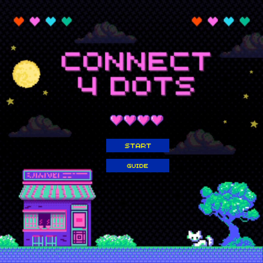
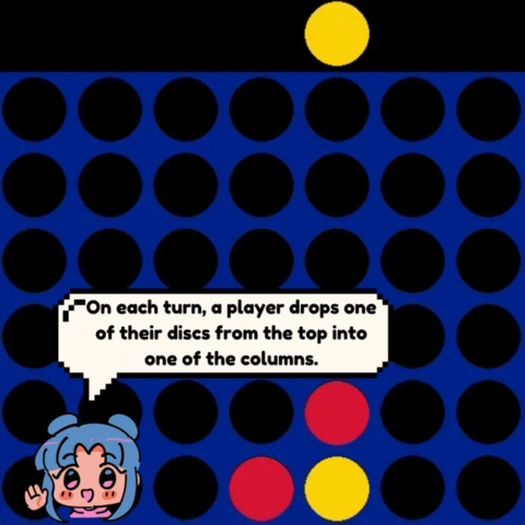
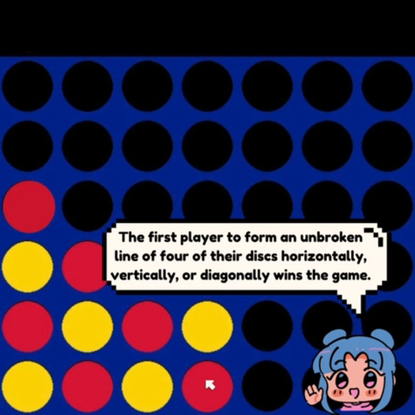
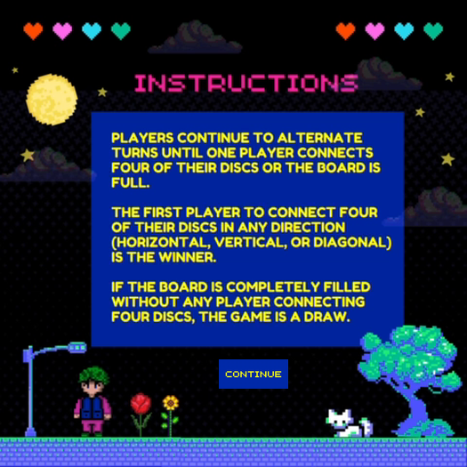
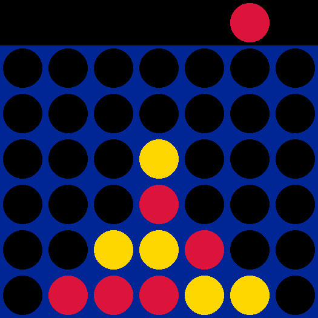
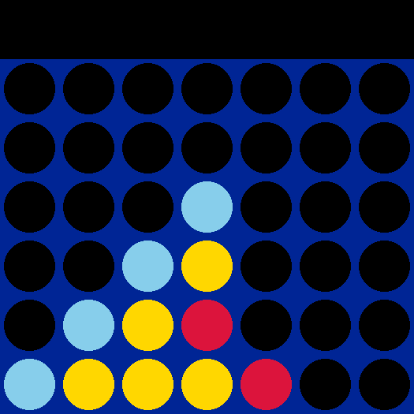
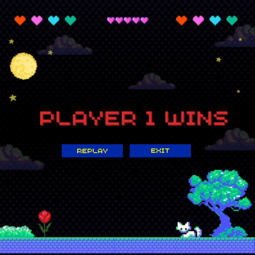

# Connect 4 Dots

A two-player game for one screen, styled like a pixel-art night scene. Players take turns dropping coloured discs into a board. The first player to line up four of their discs wins.

  

---

## How the game works

### 1. Home screen
The game opens on the home screen with background music playing. It has two buttons:

- **Start**: begin a new game
- **Guide**: watch a short walkthrough of the rules

### 2. Guide
The guide is a series of short animated tips. Click anywhere to skip to the next tip. After the last one ("Have Fun!") you are back on the home screen.

  
  
  

### 3. Instructions
Pressing **Start** opens the rules screen. Read them, then click **Continue**.

  

### 4. Loading screen
A short loading screen shows who is who:

- 🔴 **Player 1**: Red
- 🟡 **Player 2**: Yellow

  

### 5. The board
The board has **6 rows and 7 columns**. When you move the mouse over the board, the disc of the player whose turn it is follows the pointer along the top. A sound plays each time a disc drops.

  

### 6. Four in a row!
When a player connects four discs, the four winning discs **light up** so everyone can see the winning line.

  

### 7. Winner screen
The winner is announced and victory music plays. You can then:

- **Replay**: go back to the home screen and start a new game
- **Exit**: close the game

  
  

---

## How to play

### Rules
1. Two players share the same screen and take turns. **Red (Player 1) always goes first.**
2. On your turn, pick a column and drop one disc into it.
3. The disc falls to the **lowest empty space** in that column.
4. A full column won't take any more discs. Clicking one uses up your turn, so choose carefully.
5. The first player to make a line of **four of their own discs** wins. The line can be:
   - **Horizontal** (side by side) ➡️
   - **Vertical** (stacked on top of each other) ⬆️
   - **Diagonal** (in either direction) ↗️ ↘️
6. If the board fills up and nobody has four in a row, the game is a **draw**.

### Controls

| Action | How |
|---|---|
| Aim your disc | Move the mouse left or right over the board |
| Drop your disc | Click on the column you want |
| Skip to the next guide tip | Click anywhere |
| Press a button (Start, Guide, Continue, Replay, Exit) | Click it |
| Quit the game | Press **Esc** on the home, instructions or winner screen, or close the window |

### Tips
- Taking the **middle columns** early gives you more ways to make four in a row.
- Always check whether your opponent has **three in a row** and block them.
- Try to set up **two threats at once**. Your opponent can only block one of them.

---

Have fun! 🎉
