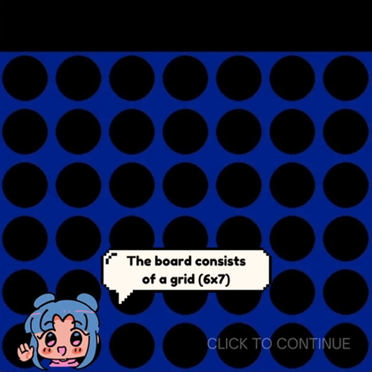
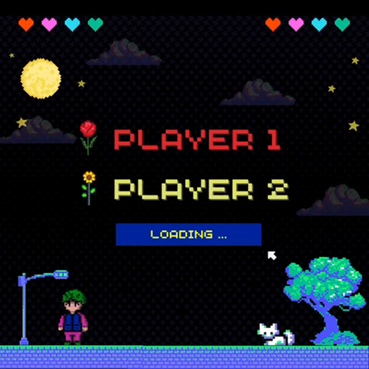
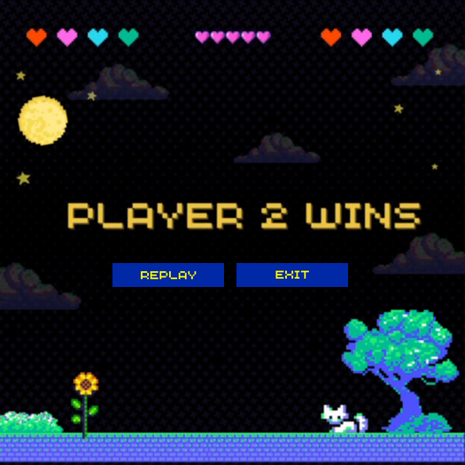

# Connect 4 Dots

**Connect 4 Dots** is a two-player strategy game designed for a shared screen, featuring a pixel-art aesthetic inspired by a night-time atmosphere. Players take turns dropping coloured discs into a vertically arranged grid, competing to connect four of their own discs in a continuous line.

The game combines classic Connect Four gameplay with animated screens, interactive visual elements, background music, and sound effects to create an engaging local multiplayer experience.

\
\
&#x20; \\
\

---

## Game Overview

### 1. Home Screen

The game begins with an interactive home screen featuring background music and two primary options:

- **Start:** Begin a new game.
- **Guide:** Explore an animated walkthrough explaining the gameplay mechanics and rules.

### 2. Interactive Game Guide

The guide introduces players to the game through a sequence of short animated instructions.

- Each screen highlights a specific gameplay concept.
- Click anywhere to advance to the next instruction.
- The final screen, *Have Fun!*, returns players to the home screen.

\
\
&#x20; \\
&#x20; \\
&#x20; \\
\

### 3. Game Instructions

Selecting **Start** opens the instructions screen, providing an overview of the rules and gameplay mechanics before the match begins.

Players can review the instructions and select **Continue** to proceed.

\
\
&#x20; \\
\

### 4. Player Introduction

A brief loading screen introduces the two players and their assigned disc colours:

- 🔴 **Player 1:** Red
- 🟡 **Player 2:** Yellow

Player 1 always takes the first turn.

\
\
&#x20; \\
\

### 5. Gameplay

The game takes place on a **6 × 7 grid** consisting of six rows and seven columns.

Gameplay features include:

- Mouse-based column selection.
- A disc preview that follows the mouse pointer across the top of the board.
- Automatic disc placement in the lowest available position within the selected column.
- Sound effects accompanying each disc drop.
- Alternating turns between the two players.

\
\
&#x20; \\
\

### 6. Winning Condition

The first player to connect four discs consecutively in a horizontal, vertical, or diagonal direction wins the game.

When a winning combination is detected, the four connected discs light up to visually highlight the winning sequence.

\
\
&#x20; \\
\

### 7. Winner Screen

Once the game concludes, a dedicated winner screen announces the result and plays victory music.

Players can choose between:

- **Replay:** Return to the home screen to start another match.
- **Exit:** Close the game.

Separate victory screens are displayed depending on which player wins.

\
\
&#x20; \\
&#x20; \\
\

---

## Rules and Gameplay

1. The game supports two players sharing a single screen.
2. **Player 1 (Red)** always makes the first move.
3. Players take turns selecting a column and dropping one disc.
4. Each disc automatically occupies the lowest available empty position in the selected column.
5. A full column cannot accommodate additional discs. Selecting a full column consumes the current turn.
6. The objective is to connect four discs of the same colour consecutively in any of the following directions:
   - **Horizontal:** Four discs in the same row.
   - **Vertical:** Four discs in the same column.
   - **Diagonal:** Four discs connected diagonally in either direction.
7. If all positions on the board are filled without either player connecting four discs, the match ends in a draw.

## Controls

| Action                     | Control                                                                           |
| -------------------------- | --------------------------------------------------------------------------------- |
| Move disc preview          | Move the mouse horizontally over the board                                        |
| Drop a disc                | Click the desired column                                                          |
| Advance guide instructions | Click anywhere                                                                    |
| Navigate game screens      | Click the corresponding button                                                    |
| Exit the game              | Press `Esc` on the home, instructions, or winner screen, or close the game window |

## Strategy Tips

- **Prioritize the centre:** Middle columns offer more opportunities to create winning combinations.
- **Watch your opponent:** Identify and block potential winning sequences before they are completed.
- **Plan multiple moves ahead:** Consider how each placement affects both your immediate opportunities and future moves.
- **Create multiple threats:** Set up two possible winning combinations simultaneously, making it harder for your opponent to defend against both.

---

## Game Highlights

- Two-player local multiplayer gameplay.
- Pixel-art-inspired night-time visual design.
- Animated introductory guide and instructions.
- Interactive disc preview and placement.
- Automatic winning-combination detection.
- Highlighted winning sequences.
- Background music and gameplay sound effects.
- Dedicated player victory screens and replay functionality.

---

Have fun! 🎉 
